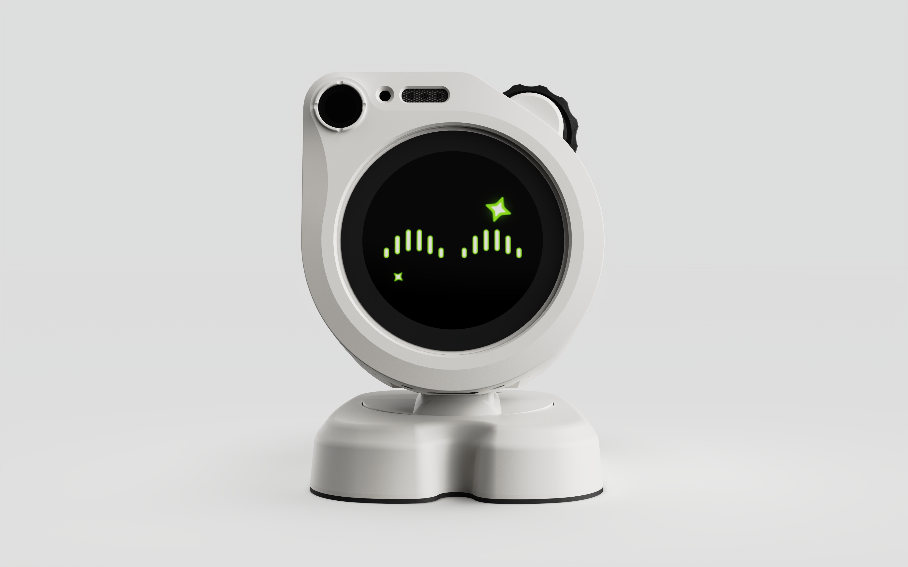
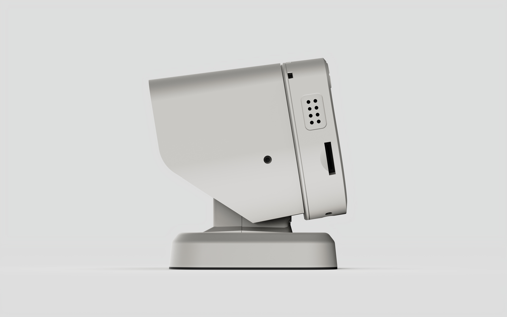
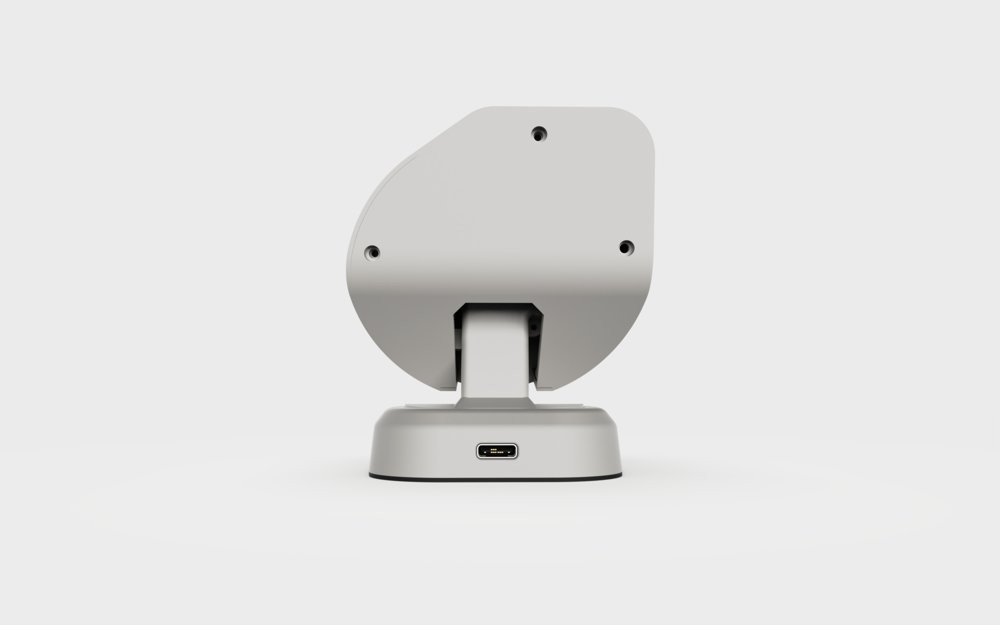

English | [简体中文](README_zh.md)

# WatcheRobot C SDK

WatcheRobot is an AI desktop robot for developers and creators. Use the C SDK to build
applications on the robot, combining its screen, camera, microphone, speaker, body movement
and lights into your own interactions.

## Product overview

<table>
<tr>
<td width="65%">

WatcheRobot consists of a head, body and charging dock:

<ul>
<li><b>Head</b>: ESP32-S3 processor, 1.45-inch touchscreen, camera, microphone, speaker and scroll wheel.</li>
<li><b>Body</b>: pan and tilt movement, body touch sensing and side lights.</li>
<li><b>Charging dock</b>: magnetic power connection and an ambient light ring.</li>
</ul>

Build a screen interface, photo tool, sound interaction or touch-controlled light application, then combine these features with your own robot movements.

This repository provides device-side C interfaces and examples. To control existing robot firmware from a computer, use the <a href="https://github.com/orulink-ai/WatcheRobot_python_sdk">Python SDK</a>.

</td>
<td width="35%" align="center">

</td>
</tr>
</table>

## Hardware overview

| Part | Main hardware | Purpose |
| --- | --- | --- |
| Main processor | ESP32-S3, 240 MHz, 8 MB PSRAM | Runs your C application and connects the screen, audio and camera |
| Screen | 1.45-inch, 412 × 412, capacitive touch | Displays text, buttons and interfaces; accepts screen input |
| Camera | OV5647, Himax HX6538 vision processor | Takes photos and supplies a sequence of images |
| Audio | Single microphone, 1 W speaker | Records and plays sound |
| Body | CKS32F103C8T6, two SG90 servos | Provides pan and tilt movement |
| Touch and lights | Body touch sensing, side RGB lights, dock RGB light ring | Touch interaction, status indication and ambient effects |
| Connections | USB-C, head-to-body connector, magnetic dock connector | Power, development connection and head-to-body communication |

<table>
<tr>
<td align="center"> Side</td>
<td align="center"> Rear</td>
</tr>
</table>

Product images and hardware details come from the product manual; see [image attribution](docs/images/product/README.md).
Hardware features do not automatically imply SDK interfaces. Current SDK support is listed below.

## Capabilities and dependencies

| Available | Capability | Controller / driver | Component | Version |
| --- | --- | --- | --- | --- |
| ✓ | Display | SPD2010 | [Display driver](https://components.espressif.com/components/espressif/esp_lcd_spd2010/versions/1.0.1/readme) | 1.0.1 |
| ✓ | Screen touch | SPD2010 | [Touch driver](https://components.espressif.com/components/espressif/esp_lcd_touch_spd2010/versions/0.0.1/readme) | 0.0.1, locally adapted |
| ✓ | UI drawing | LVGL | [LVGL](https://components.espressif.com/components/lvgl/lvgl/versions/8.4.0/readme) · [UI port](components/esp_lvgl_port/README.md) | 8.4.0 / 1.4.0-custom.1 |
| ✓ | Speaker playback | ES8311 | [Audio component](components/esp_codec_dev/README.md) · [Guide](docs/api/audio.md) | 1.2.0, locally adapted |
| ✓ | Microphone recording | ES7243 / ES7243E | [Audio component](components/esp_codec_dev/README.md) · [Guide](docs/api/audio.md) | 1.2.0, locally adapted |
| ✓ | Photos and image stream | OV5647 / Himax HX6538 | [Camera interface](components/sdk/watcher_hw_camera/README.md) | Included in this source repository |
| ✓ | Body movement | Two servos, body controller | [Movement interface](docs/api/body.md) | Included in this source repository |
| ✓ | Body touch | TTP223 | [Touch events](docs/api/body.md) | Included in this source repository |
| ✓ | Side and dock lights | WS2812B2020 | [Light interface](docs/api/body.md) | Included in this source repository |

✓ indicates an interface provided by the source, not completed whole-device testing.
Repository components have not been formally published to Espressif's Component Registry.
See [build requirements](docs/development.md#dependencies) for paired firmware and dependency details.

## Examples

| Example | What you can try | Guide |
| --- | --- | --- |
| Touch-controlled lights | Touch the body to turn green lights on, release to clear them, and log touch events | [body](examples/body/README.md) |
| Camera, audio and screen | Take photos, record and replay sound, test the speaker and use screen controls | [head](examples/head/README.md) |
| Combined application | Combine touch-controlled lights with camera, sound and screen controls | [robot](examples/robot/README.md) |
| Hardware check | Follow screen prompts to inspect the screen, sound, touch, lights and movement | [hardware_check](examples/hardware_check/README.md) |

## Development documentation

Use **ESP-IDF 6.0.2 / ESP32-S3** and **LVGL 8.4.0** for the screen interface.

- [API usage guide](docs/getting-started.md): initialization and short examples organized by feature.
- [Find an interface by task](docs/api/README.md): movement, lights, touch, camera, audio and screen.
- [Development and contributing](docs/development.md): SDK changes, tests and local packaging for maintainers.

This is a development preview. Flashing replaces device software: prepare backups and a complete official
recovery bundle using the [example precautions](examples/README.md). Read [movement precautions](docs/servo-open-loop.md) before enabling
movement. [Verification results](docs/verification.md) distinguish software checks from pending hardware acceptance.

## License

First-party code is [Apache-2.0](LICENSE). Third-party components and assets retain their own licenses and attribution.
