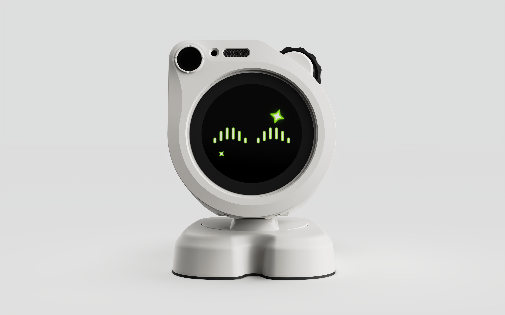
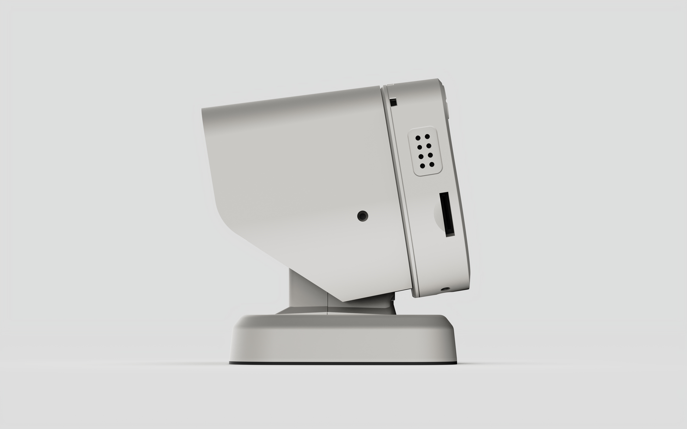
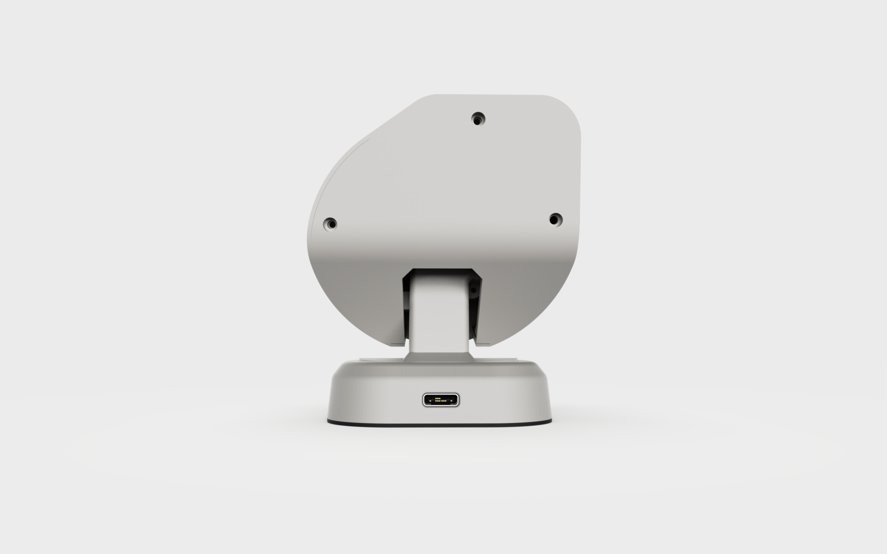

[English](README.md) | 简体中文

# WatcheRobot C SDK

WatcheRobot（小沃）是一款面向开发者和创作者的 AI 桌面机器人。C SDK 用于在机器人上编写自己的应用，
将屏幕、摄像头、麦克风、扬声器、身体运动和灯光组合成新的交互体验。

## 产品概述

<table>
<tr>
<td width="65%">

WatcheRobot 由头部、身体和充电底座组成：

<ul>
<li><b>头部</b>：ESP32-S3 主控、1.45 英寸触摸屏、摄像头、麦克风、扬声器和滚轮。</li>
<li><b>身体</b>：左右转动与上下俯仰、身体触摸、侧边灯光。</li>
<li><b>充电底座</b>：磁吸供电和环形氛围灯。</li>
</ul>

你可以为它制作屏幕界面、拍照工具、声音交互或触摸灯光应用，也可以在此基础上设计自己的机器人动作。

本仓库提供设备端 C 接口和示例。若希望在电脑上通过 Python 控制现有机器人固件，请使用 <a href="https://github.com/orulink-ai/WatcheRobot_python_sdk">Python SDK</a>。

</td>
<td width="35%" align="center">

</td>
</tr>
</table>

## 硬件概览

| 部分 | 主要硬件 | 用途 |
| --- | --- | --- |
| 主控 | ESP32-S3，240 MHz，8 MB PSRAM | 运行你的 C 应用，连接屏幕、声音和相机 |
| 屏幕 | 1.45 英寸，412 × 412，电容触摸 | 显示文字、按钮和界面，响应屏幕操作 |
| 摄像头 | OV5647，Himax HX6538 视觉处理器 | 拍照和获取连续画面 |
| 声音 | 单麦克风、1 W 扬声器 | 录音与播放声音 |
| 身体 | CKS32F103C8T6、两个 SG90 舵机 | 左右转动、上下俯仰 |
| 触摸与灯光 | 身体触摸感应、侧边 RGB 灯、底座环形 RGB 灯 | 触摸互动、状态提示和氛围效果 |
| 接口 | USB-C、头部与身体连接口、底座磁吸接口 | 供电、开发连接及头部与身体通信 |

<table>
<tr>
<td align="center"> 侧面</td>
<td align="center"> 背面</td>
</tr>
</table>

## 开始使用

SDK 当前为开发预览。

按照[首次运行教程](docs/getting-started_zh.md)安装 ESP-IDF，构建并烧录显示示例，再修改屏幕上的文字。

SDK 支持屏幕界面与触摸、JPEG 拍照与连续取图、PCM 录音与播放、身体转动、身体短按事件、灯光及端侧人脸检测。运行前查看[硬件与配套固件要求](docs/hardware-compatibility.md)；人脸检测还需[安装配套模型](docs/model-deployment.md)。

- [功能指南](docs/features.md)：按功能查找调用入口和使用文档。
- [示例目录](examples/README.md)：选择显示、声音、灯光或视觉等可运行工程。
- [贡献指南](CONTRIBUTING.md)：修改 SDK 时的构建检查和提交规范。

## 许可

第一方代码采用 [Apache-2.0](LICENSE)。第三方组件和素材保留各自的许可证与署名。
