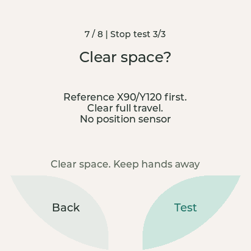

English | [简体中文](README_zh.md)

# Check the robot's hardware, one item at a time

For someone with a real board who wants to check its screen, camera, sound,
touch, lights and motion. The `hardware_check` example guides you through **8 groups,
26 manual observations**. It needs no Python SDK, Daemon, server, SD card, model or
private repository. It is not factory certification or an emergency-stop device.

## 1. Prepare safely

Connect and power the head and body. See [first run](../../docs/getting-started.md) for environment setup. Flash this example through the ESP32 SERIAL-B port.

Before choosing a motion item, read [motion safety](../../docs/api/body.md#motion-safety-english): the application
**cannot read the angle a servo actually reaches**. Clear the **entire travel** and keep manual power
disconnection available. The first command is **X90/Y120**, followed by **X93/Y120**
or **X90/Y123**. With an unknown start position, the first move can be large; this
is not homing or calibration, and a three-degree command is not measured travel.

## 2. Build and start

From the **WatcheRobot_c_sdk repository root**, with ESP-IDF **6.0.2** activated,
build the example:

```sh
idf.py -C examples/hardware_check build
idf.py -C examples/hardware_check -p PORT flash monitor
```

Expected output: `examples/hardware_check/build/watcher_hw_hardware_check.bin` and matching flash files; building does not write to the device.
The project uses ESP32-S3, 16 MB flash, custom partitions, 80 MHz octal PSRAM and LVGL 8.4.0.
Replace PORT with the ESP32 SERIAL-B port. Flashing replaces the application and partitions; back up needed data first.

Expected log: `Hardware check v2 | curved zones`. Expected screen: **Hardware check**.
No test starts automatically. Exit monitor with Ctrl+].

## 3. Work through the screen

Tap **Test** to enter an item, read the instruction, then tap **Test** to run it.
Observe the actual hardware before choosing **Next** (accept) or **Not OK** (issue).
On the issue page, **Back** retries; **Next** keeps the issue and continues.
Missing/skipped items do not pass.

The whole pale curved regions at lower left/right are touch targets, not just
the labels. The central gap and outside arc are inactive. The report has two pages
of four groups; tap a group/item to retest. A new session asks before clearing
results. All results are in RAM and disappear on reboot: save them externally.

| Group | What happens | What you confirm |
| --- | --- | --- |
| Screen | Tap 1 → 2 → 3 | Readable display and real finger-touch response |
| Camera | 3/2/1 photo, then five-second live view | Fresh image and changing frame count; tap photo to enlarge |
| Speaker | Fixed CC0 voice, then one-second tone | Clear audible output, not just a progress bar |
| Microphone | Countdown and three-second recording, then separate Replay | Raw input follows speech; replay is audible without squeal |
| Body touch | Tap/release, then hold/release on one sensor | Press → Release → Press → Long press → Release, without motors/lights |
| Lights | Side/Bottom: red, green, blue, dim, bright, breathing, off | Each of 14 zone/color/effect observations |
| Motion | Separate safety confirmation for each axis and STOP test | Safe movement and a physically observed stop |
| Together | Twenty seconds of camera, voice, alternating green zones and touch events | Components work together, with no motor or simultaneous record/play |

The touch test waits for short- and long-press events. Long press depends on the sensor and firmware; for short-press-only devices, use Back and Skip to leave the item.

### Motion result

The red **STOP** stays red while waiting; duplicate requests are disabled.
`DONE/STOPPED` is only a software report: you must observe the body stop.
Natural completion counts as an issue in the stop test. Motion errors lock body
controls until reboot. Disconnection prevents STOP delivery, so paired STM32 safety
is required. Reboot is not proof that the cause of a fault has been removed.

The application cannot measure actual servo angles. See [motion safety](../../docs/api/body.md#motion-safety-english).


Illustration retained from the [original public artwork](https://github.com/orulink-ai/WatcheRobot-public/blob/eb78c212999374c9afd48de9c160c73991e646ae/docs/images/embedded-sdk/hardware-check-motion-safety.png); not a device photograph.

This LVGL (screen graphics library) host-rendered illustration is not a robot photograph.

### Sound and cancellation

Voice/Record/Replay open **Audio setup**. Output is 0–95 (default 90); 0 mutes.
Replay requests **32x** boost, but peak limiting can reduce the displayed actual
multiplier. It affects only a recording copy, not microphone analog gain or fixed
voice/tone, and can amplify background noise. Raw PCM (uncompressed sound samples)
is not denoised. Stop if harsh or feeding back.

Photos and recordings stay in RAM. Fixed voice is a licensed flash asset:
[asset source and license](../common/assets/README.md).

**Stop**: tap once and wait for cleanup. Repeated taps cannot bypass it. If a
function is disabled after cleanup fails, do not force it to continue; other ready
functions may still be used. Software stop does not mean physical stop: for motion,
observe the mechanism and disconnect power manually if unsafe. Do not automatically
retry an old motion; any new movement requires a new user action. For implementation
rules, see the [body](../../docs/api/body.md), [camera](../../docs/api/camera.md), [audio](../../docs/api/audio.md)
and [display](../../docs/api/display.md) API guides.

## 4. Optional silent serial check

This checks repeated photo/live-view cleanup, cancellation/reuse and PCM capture.
It does **not** flash, scan ports, move motors, play sounds or accept manual items.
It returns to the **untested** welcome screen.

Close monitor, ensure no one operates the screen, and let only one process own the
verified port. The active ESP-IDF Python needs `pyserial`. From repository root,
choose one wrapper:

```sh
bash examples/hardware_check/verify.sh --port <PORT>
```

```powershell
./examples/hardware_check/verify.ps1 --port <PORT>
```

Optional `--log <LOCAL_LOG_PATH>` saves diagnostics. Exit code 0 means the sequence
completed, 1 timeout/mismatch, 2 invalid arguments.
Review logs for device identifiers/private images before sharing.

Manual monitor commands: `diag status`, `diag photo`, `diag stream`, `diag record`,
`diag cancel`, `diag reset`, `diag snapshot`. No serial motor/light/speaker commands
are provided. `diag reset` does not clear a body fault lock. The RGB565 snapshot
(a software image) cannot prove touch, sound or motion.

## 5. Save the result

Save a text file or spreadsheet before reboot. Use one row per item:

```text
Item | Pass/Issue/Untested | What actually happened
Body touch | Pass | Press and release events appeared for the tested sensor
X-axis motion | Untested | Safe space for the entire travel was not available
```

Results are held in memory and cleared on reboot. To report a problem, include the affected item, steps and error log.
