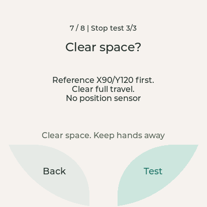

[English](README.md) | 简体中文

# 逐项检查机器人的硬件

`hardware_check` 示例通过触摸屏引导检查屏幕、相机、声音、触摸、灯光和运动，直接在机器人上运行。

## 1. 做好安全准备

准备已连接并供电的头部和身体，环境安装见[上手教程](../../docs/getting-started_zh.md)。本示例烧录到 ESP32 的 SERIAL-B 端口。

选择运动项前阅读[运动安全](../../docs/api/body.md#motion-safety)。测试先发送 **X90/Y120**，再发送 **X93/Y120** 或 **X90/Y123**；起点未知时，首次移动可能较大。

## 2. 构建并启动

在 **WatcheRobot_c_sdk 仓库根目录**、已激活 ESP-IDF **6.0.2** 的终端运行，
执行构建：

```sh
idf.py -C examples/hardware_check build
idf.py -C examples/hardware_check -p PORT flash monitor
```

预期生成 `examples/hardware_check/build/watcher_hw_hardware_check.bin` 及配套烧录文件；构建不会写入设备。
工程使用 ESP32-S3、16 MB flash、自定义分区、80 MHz 八线 PSRAM 和 LVGL 8.4.0。
PORT 替换为 ESP32 的 SERIAL-B 端口。首次烧录会替换应用和分区，需保留的数据请先备份。

预期日志：`Hardware check v2 | curved zones`；屏幕显示 **Hardware check**。
不会自动开始测试。Ctrl+] 退出 monitor。

## 3. 按屏幕提示逐项检查

点 **Test** 进入细项，先读提示，再点 **Test** 开始。观察实物后选 **Next**（接受）
或 **Not OK**（问题）。问题页 **Back** 重试，**Next** 保留问题继续；缺失或跳过不能算通过。

左下／右下整片浅色弧形区域均可点击，不只是文字；中间留白与弧外不响应。报告分两页，
每页四组，可点组、再点细项复测。新会话清空前会确认。结果只在内存，重启丢失，请另行保存。

| 组 | 实际操作 | 人工确认 |
| --- | --- | --- |
| 屏幕 | 按 1 → 2 → 3 | 可读，真实手指点击有响应 |
| 相机 | 3/2/1 拍照，再五秒实时画面 | 新图像与帧计数更新，照片可点开大图 |
| 扬声器 | 固定 CC0 语音，再一秒测试音 | 实际清晰可听，不能只看进度条 |
| 麦克风 | 倒计时后三秒录音，再单独 Replay | 原始电平随讲话变化，回放可听、不啸叫 |
| 身体触摸 | 轻触并释放同一传感器 | 观察 Press → Release；退出方式见下文，不带动灯／电机 |
| 灯光 | Side／Bottom 各红绿蓝、暗亮、呼吸、关闭 | 14 项逐区、逐色／效果确认 |
| 运动 | 每个轴与 STOP 测试均单独安全确认 | 动作安全，实物确实停止 |
| 组合 | 二十秒画面、语音、交替绿灯和触摸事件 | 同时工作，不驱动电机、不同时录音播放 |

**身体触摸**：目前仅支持短按，长按支持尚待确认。检查程序仍会等待长按事件；观察到 Press → Release 后，用 Back 退出该项并选择 Skip。该项不会仅凭短按自动通过。

### 如何判断运动结果

红色 **STOP** 等待结果时保持红色，不能重复提交。`DONE/STOPPED` 只是软件报告，
仍须看见实物停住。停止测试若自然完成，应记问题。运动错误锁定身体控制直到重启；
断线无法送达 STOP，必须依赖配套 STM32 安全机制。重启不代表故障原因已经消除。



### 声音与取消操作

Voice／Record／Replay 先进入 **Audio setup**。输出 0–95，默认 90，0 为静音。
回放请求 **32x** 放大，但峰值保护可能降低屏幕显示的实际倍数。它只处理录音副本，
不改麦克风模拟增益、不影响固定语音／测试音，也可能放大底噪。原始 PCM（未压缩声音采样）
不提供降噪；刺耳或啸叫时停止。

照片与录音只在内存。固定语音是闪存内的许可素材，见[素材来源与许可](../common/assets/README.md)。

**Stop** 点一次后等待清理完成，连点不能跳过等待。清理失败后若功能被禁用，不要强行继续；
其他已就绪功能仍可使用。重新尝试运动前，按[运动安全](../../docs/api/body.md#motion-safety)处理。修改实现时，另读
[身体](../../docs/api/body.md)、[相机](../../docs/api/camera.md)、[音频](../../docs/api/audio.md)和[屏幕](../../docs/api/display.md) API 的使用规则。

## 4. 可选静默串口检查

此检查验证反复拍照、实时画面清理、取消后复用及 PCM 采集。**不会**烧录、扫描端口、
驱动电机、播放声音或替人接受测试项；完成后回到**未测试**欢迎页。

先退出 monitor，期间不要操作屏幕，并确保只有一个进程使用已确认端口。当前 ESP-IDF Python
需安装 `pyserial`。在仓库根目录任选一个入口：

```sh
bash examples/hardware_check/verify.sh --port <PORT>
```

```powershell
./examples/hardware_check/verify.ps1 --port <PORT>
```

可加 `--log <LOCAL_LOG_PATH>` 保存诊断。退出码 0 表示流程完成，1 超时／结果不匹配，
2 参数错误。分享日志前检查设备标识及私人图像。

monitor 手动命令：`diag status`、`diag photo`、`diag stream`、`diag record`、
`diag cancel`、`diag reset`、`diag snapshot`。没有串口电机／灯／扬声器命令。
`diag reset` 不清除身体故障锁；`diag snapshot` 将当前界面导出为 RGB565 图像。

## 5. 反馈问题

附上发生问题的项目、操作步骤和错误日志。结果保存在内存中，重启会清除。
